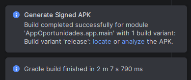
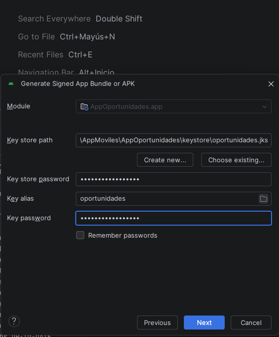

# AppOportunidades

Aplicación Android para registrar y gestionar oportunidades de eventos y activaciones corporativas (Caso 003V: Gestión móvil de oportunidades y activaciones corporativas). Corresponde a la Evaluación Parcial 4 de Desarrollo de Aplicaciones Móviles, DSY1105, y continúa el trabajo de la Evaluación Parcial 2.

## 1. Nombre del proyecto

AppOportunidades: app móvil (Kotlin, Jetpack Compose, Material 3, MVVM) con dos microservicios propios en Spring Boot y consumo de una API externa.

## 2. Integrantes

- Andrés Carrasco

Toda la información usada para la demostración es ficticia: usuarios, organizaciones, contactos, costos y resultados.

## 3. Funcionalidades

### Ingreso con tres perfiles

La app tiene un login validado por el microservicio de usuarios. Cada perfil ve su propio menú y sus propias acciones, según el diagrama de flujo del caso:

| Perfil | Correo | Clave | Qué puede hacer |
|---|---|---|---|
| Ejecutivo comercial | `ejecutivo@example.com` | `Demo2026` | Registrar oportunidades (evento, organización, contacto, detalles y fecha), escanear un QR que deja la oportunidad registrada, registrar gestiones y propuestas enviadas. |
| Supervisor comercial | `supervisor@example.com` | `Demo2026` | Ver la lista de oportunidades con búsqueda y filtros, revisar el detalle y el seguimiento, gestionar el estado (Pendiente, En gestión, Confirmada, Descartada), asignar responsable, cambiar la prioridad y eliminar oportunidades. |
| Gestión de activaciones | `activaciones@example.com` | `Demo2026` | Coordinar la activación (confirmar participación, registrar condiciones, asignar responsable, agregar evidencias con foto) y registrar resultados (resultado, observaciones y próximas acciones). |

En el login hay un botón por cada cuenta de prueba que completa el correo. Para **cerrar sesión o cambiar de perfil** se usa el ícono de salida en la barra superior de Inicio o el botón "Cerrar sesión / Cambiar perfil" en Perfil. Ambos vuelven al login.

Si el microservicio de usuarios no está disponible, la app permite entrar con las mismas cuentas de prueba e informa que el ingreso es sin conexión.

### Otras funciones

- Avisos de eventos próximos, contactos pendientes, propuestas sin respuesta y seguimientos atrasados (pestaña Pendientes).
- Historial de cada oportunidad, incluidos los cambios de estado.
- Organizaciones y contactos ficticios.
- Lectura de códigos QR con CameraX y ML Kit.
- Feriados de Chile obtenidos desde una API externa, con aviso si un evento registrado cae en un feriado.
- Preferencia de avisos guardada con DataStore y foto de perfil con cámara o galería.

### Datos: microservicio y Room

- Las **oportunidades** se crean, consultan, modifican, cambian de estado y eliminan en el microservicio `ms-oportunidades` (CRUD completo). Cada respuesta se guarda también en Room, así que si se pierde la conexión la app sigue mostrando la última información descargada.
- **Organizaciones, contactos, gestiones, activaciones y resultados** se guardan en Room, igual que en el diagrama del caso.
- La **API externa** (feriados) se muestra en su propia pantalla y no se mezcla con los datos propios.

### Códigos QR de prueba

En la carpeta `qr/` hay 3 códigos, cada uno con una oportunidad ficticia. Junto a cada imagen hay un `.txt` con el mismo contenido:

- `qr_1_feria_empresarial.png`
- `qr_2_jornada_beneficios.png`
- `qr_3_actividad_municipal.png`

Para usarlos, ingresa como ejecutivo comercial, presiona "Escanear QR de oportunidad", enfoca el código y presiona **Registrar oportunidad**:

1. Si la organización del código no existe, se crea.
2. La oportunidad se guarda en el microservicio.
3. La app muestra el resumen.

Con "Revisar en el formulario" se pueden ver y editar los datos antes de guardar.

## 4. Endpoints utilizados

### Microservicios propios (carpeta `microservicios/`)

Desde el emulador, la app usa `http://10.0.2.2` para llegar al computador.

**ms-usuarios** (puerto 8081, base de datos H2):

| Método | Endpoint | Uso en la app |
|---|---|---|
| POST | `/api/usuarios/login` | Inicio de sesión y obtención del perfil |
| GET | `/api/usuarios` | Listado de usuarios |
| GET | `/api/usuarios/{id}` | Consulta de un usuario |
| POST | `/api/usuarios` | Creación de usuario |
| PUT | `/api/usuarios/{id}` | Modificación de usuario |
| DELETE | `/api/usuarios/{id}` | Eliminación de usuario |

**ms-oportunidades** (puerto 8082, base de datos H2):

| Método | Endpoint | Uso en la app |
|---|---|---|
| GET | `/api/oportunidades` | Lista de oportunidades (botón "Actualizar desde el servidor") |
| GET | `/api/oportunidades/{id}` | Consulta de una oportunidad |
| POST | `/api/oportunidades` | Registrar oportunidad (formulario o QR) |
| PUT | `/api/oportunidades/{id}` | Editar oportunidad y decisión del supervisor |
| PATCH | `/api/oportunidades/{id}/estado` | Confirmar participación desde Coordinar activación |
| DELETE | `/api/oportunidades/{id}` | Eliminar oportunidad (supervisor) |

Las consolas H2 quedan en `http://localhost:8081/h2-console` y `http://localhost:8082/h2-console`. El detalle de cada endpoint, con ejemplos JSON, está en `microservicios/README.md`.

### API externa

| Método | Endpoint | Uso en la app |
|---|---|---|
| GET | `https://date.nager.at/api/v3/PublicHolidays/{año}/CL` | Pantalla "Feriados de Chile" (año actual y siguiente) |

## 5. Pasos para ejecutar

### Microservicios

1. Tener Java 21 o superior.
2. En una terminal, ejecutar el servicio de usuarios:
   ```
   cd microservicios/ms-usuarios
   mvnw spring-boot:run
   ```
3. En otra terminal, ejecutar el servicio de oportunidades:
   ```
   cd microservicios/ms-oportunidades
   mvnw spring-boot:run
   ```
   En PowerShell se escribe `.\mvnw spring-boot:run`. La primera vez se descarga Maven automáticamente.
4. Comprobar que responden: http://localhost:8081/api/usuarios y http://localhost:8082/api/oportunidades.

### App móvil

1. Abrir la carpeta del proyecto en Android Studio.
2. En Settings > Build Tools > Gradle, usar el JDK 21 (Gradle JDK).
3. Sincronizar Gradle e instalar el SDK 37 si se solicita.
4. Iniciar un emulador con Android 13 (API 33) o superior (probado con Pixel 7, API 34).
5. Seleccionar el módulo `app` y presionar Run.
6. Ingresar con una de las cuentas de prueba.

Para usar un teléfono físico, en `remote/RetrofitInstance.kt` cambia `HOST` por la IP del computador en la misma red Wi-Fi, por ejemplo `http://192.168.1.10`. También hay que permitir los puertos 8081 y 8082 en el firewall de Windows.

### Pruebas unitarias

- Las pruebas de lógica están en `app/src/test/java` y usan Kotest, JUnit 5, MockK y kotlinx-coroutines-test. Cubren todos los ViewModel de la lógica y los Repository.
- La prueba de interfaz está en `app/src/androidTest/java` y usa Compose UI Test con MockK.
- Para ejecutarlas, en Android Studio haz clic derecho en la carpeta de pruebas y elige "Run 'Tests in ...'". Para ver la cobertura, usa "Run with Coverage".
- Los microservicios tienen sus pruebas de servicio con JUnit 5 y Mockito. Se ejecutan con `mvnw test`.

## 6. APK firmado y llave

- Llave: `keystore/oportunidades.jks`. El alias es `oportunidades` y la clave del almacén y de la llave es `Oportunidades2026` (proyecto académico).
- La configuración de firma está en `app/build.gradle.kts`, en `signingConfigs` → `release`.
- Para generar el APK: Build > Generate Signed App Bundle or APK > APK, con la misma llave. También se puede ejecutar `gradlew assembleRelease`.
- El APK firmado queda en `app/build/outputs/apk/release/app-release.apk`. Hay una copia en `apk/app-release.apk`.

Capturas:




## Organización del código

Sigue la estructura MVVM de las guías del curso:

| Carpeta | Contenido |
|---|---|
| `model` | Estados de formularios (UiState), errores, catálogos, fechas y modelos de la API (Usuario, Feriado) |
| `model/data/local` | Entidades, DAO y base Room |
| `remote` | `RetrofitInstance` y las interfaces de los servicios (usuarios, oportunidades, feriados) |
| `repository` | Un repositorio por fuente de datos. Los ViewModel los reciben por constructor, lo que permite simularlos en las pruebas. |
| `viewmodel` | Estado, validaciones (`validarFormulario`), guardado y eventos de navegación |
| `navigation` | Rutas y conexión entre pantallas según el perfil |
| `ui` | Pantallas, componentes, tema y lector QR |

## Planificación

Tablero de Trello (público): https://trello.com/b/ddjxbRZd/dsy1105-parcial-2-appoportunidades
